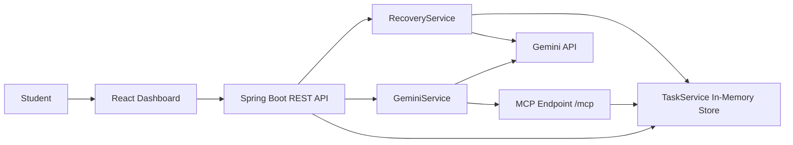

# TaskPilot — AI Study Recovery Agent

**Built for the Amazon Developer Hackathon 2026 · Alexa+ Track**

[](https://task-pilot-ai-study-recovery-agent.vercel.app/)
[](https://taskpilot-ai-study-recovery-agent.onrender.com)
[](https://github.com/aryangaikwad-966/TaskPilot-AI-Study-Recovery-Agent)

TaskPilot is an AI-assisted study recovery agent that helps students turn missed study sessions into actionable recovery proposals while keeping task changes under user control.

**Hackathon:** [Amazon Developer Hackathon 2026](https://amazonappdev2026.devpost.com/)  
**Track:** Alexa+  
**MCP Transport:** Streamable HTTP  
**MCP Protocol Version:** `2025-11-25`

> **Integration note:** TaskPilot provides a self-hosted MCP server for compatible clients. Direct integration with an Alexa+ device or production environment has not been verified.

## Live Demo

- **Frontend:** [Open TaskPilot](https://task-pilot-ai-study-recovery-agent.vercel.app/)
- **Backend API:** [Open Render service](https://taskpilot-ai-study-recovery-agent.onrender.com)
- **GitHub Repository:** [View source code](https://github.com/aryangaikwad-966/TaskPilot-AI-Study-Recovery-Agent)
- **Hackathon Rules:** [Official rules](https://amazonappdev2026.devpost.com/rules)

## The Problem

Students can fall behind when study sessions are missed and competing tasks make it difficult to decide what to prioritize. Generic AI-generated schedules may suggest changes without grounding recommendations in existing tasks or preserving user control.

## The Solution

TaskPilot combines task management, AI-assisted recovery planning, and MCP-based task operations in one application.

It retrieves pending tasks, generates a recovery proposal using Gemini when configured, and allows the student to review the proposal before approving supported task changes.

**The AI proposes. The student decides.**

## Key Features

- **Task Management:** Create, list, filter, and complete study tasks.
- **AI Study Recovery:** Generate recovery proposals from existing pending tasks using Gemini when configured.
- **Human Approval:** Review recommendations before supported task changes are applied.
- **Task Inspector:** Inspect task information through a read-only workflow that uses the MCP `list_tasks` tool.
- **MCP Integration:** Expose supported task operations through a self-hosted MCP endpoint.
- **Fallback Handling:** Return a clearly labelled local recovery proposal when the Gemini API key is missing.
- **Error Handling:** Handle supported API errors, timeouts, and invalid tool calls.

## Architecture



The frontend communicates with the Spring Boot backend through REST APIs. The recovery service prepares AI-assisted proposals, while MCP tools expose supported task operations through the same in-memory task service.

## Technology Stack

| Technology | Purpose |
|---|---|
| Java 17 | Backend runtime |
| Spring Boot 3.3 | REST API and backend services |
| Maven | Backend build tool |
| React 19 | Frontend interface |
| TypeScript | Frontend type safety |
| Vite | Frontend development and build tooling |
| Gemini API | AI recovery proposals and Task Inspector |
| MCP Java SDK schemas 2.0.1 | MCP protocol types |
| JUnit 5 and Mockito | Backend testing |
| Vercel | Frontend hosting |
| Render | Backend hosting |

## MCP Integration

TaskPilot exposes task-management tools through a self-hosted MCP endpoint.

| Property | Details |
|---|---|
| Endpoint | `POST /mcp` |
| Transport | Streamable HTTP |
| Protocol version | `2025-11-25` |
| Message format | JSON-RPC |
| Storage | Shared in-memory `TaskService` |

### Available Tools

| Tool | Input | Effect |
|---|---|---|
| `add_task` | `title` — string | Creates a task |
| `list_tasks` | `status` — `ALL`, `PENDING`, or `COMPLETED` | Reads tasks |
| `complete_task` | `task_id` | Marks a task as completed |

These tools operate on the same task service used by the REST API.

The documented MCP workflow includes initialization, tool discovery, and tool execution:

1. `initialize`
2. `notifications/initialized`
3. `tools/list`
4. `tools/call`

The implementation has been verified locally through Spring MockMvc and direct HTTP testing. It has not been independently verified against a third-party MCP client binary or an Alexa+ production environment.

## AI Recovery Workflow

1. The backend retrieves the current pending tasks.
2. `RecoveryService` prepares context for the recovery proposal using task information and the user's request.
3. Gemini generates a structured proposal containing an explanation, recommended tasks, deferred tasks, and assumptions.
4. The proposal is returned to the frontend without immediately changing task state.
5. **Approve** completes matching pending recommended tasks.
6. **Cancel or Revise** leaves task state unchanged.
7. When `GEMINI_API_KEY` is missing, the backend returns a clearly labelled local fallback proposal.

AI service errors and timeouts are handled according to the implemented backend behavior. Live Gemini functionality depends on valid credentials and model availability.

## REST API Reference

The following endpoints describe the documented application API. Confirm request and response schemas against the implementation when integrating another client.

| Method | Endpoint | Purpose |
|---|---|---|
| `GET` | `/api/tasks?status=ALL` | List tasks and counts |
| `GET` | `/api/tasks?status=PENDING` | List pending tasks |
| `GET` | `/api/tasks?status=COMPLETED` | List completed tasks |
| `POST` | `/api/tasks` | Create a task |
| `PATCH` | `/api/tasks/{id}/complete` | Complete a task |
| `POST` | `/api/recovery` | Generate a recovery proposal |
| `POST` | `/api/recovery/approve` | Approve a proposal using task IDs |
| `POST` | `/api/chat` | Send a request to the read-only Task Inspector |

### Example: Create a Task

```bash
curl -X POST http://localhost:8080/api/tasks \
  -H "Content-Type: application/json" \
  -d '{"title":"Revise operating systems"}'
```

### Example: List Pending Tasks

```bash
curl "http://localhost:8080/api/tasks?status=PENDING"
```

## Project Structure

```text
TaskPilot-AI-Study-Recovery-Agent/
├── Backend/
│   ├── pom.xml
│   ├── Dockerfile
│   └── src/
│       ├── main/
│       │   └── java/com/taskpilot/
│       │       ├── controller/
│       │       ├── service/
│       │       ├── mcp/
│       │       └── model/
│       └── test/
├── Frontend/
│   ├── package.json
│   └── src/
│       ├── App.tsx
│       ├── App.css
│       ├── api.ts
│       └── types.ts
├── LICENSE
└── README.md
```

## Prerequisites

- Java 17 or later
- Maven 3.6 or later
- Node.js 18 or later
- npm
- A Gemini API key for live AI functionality

## Local Setup

### 1. Clone the Repository

```bash
git clone https://github.com/aryangaikwad-966/TaskPilot-AI-Study-Recovery-Agent.git
cd TaskPilot-AI-Study-Recovery-Agent
```

### 2. Configure and Start the Backend

```bash
cd Backend
export GEMINI_API_KEY=YOUR_GEMINI_API_KEY
mvn spring-boot:run
```

The backend is expected to listen on `http://localhost:8080` under the default local configuration.

If no Gemini API key is configured, the recovery fallback can be used where supported by the application.

### 3. Start the Frontend

Open a second terminal:

```bash
cd Frontend
npm ci
npm run dev
```

Open the local frontend at:

http://localhost:5173

The frontend must be configured to use the correct backend base URL.

## Environment Variables

| Variable | Service | Purpose |
|---|---|---|
| `GEMINI_API_KEY` | Backend | Authenticates requests to Gemini |
| `GEMINI_MODEL` | Backend | Configures the Gemini model |
| `TASKPILOT_CORS_ALLOWED_ORIGINS` | Backend | Configures permitted frontend origins |
| `PORT` | Backend | Configures the server listening port where supported |
| `VITE_API_BASE_URL` | Frontend | Configures the backend API base URL |

The exact defaults depend on the application configuration.

**Security:** Keep Gemini credentials on the backend. Never commit secrets to Git or expose API keys through frontend environment variables or bundled JavaScript.

## Testing

### Backend

```bash
cd Backend
mvn test
```

### Frontend

```bash
cd Frontend
npm run build
npm run lint
```

The project's reported verification results are 40 passing backend tests, with frontend build and lint checks passing. Re-run the commands against the current commit to confirm the latest results.

## Deployment

TaskPilot is deployed using the following services:

| Component | Provider | URL |
|---|---|---|
| Frontend | Vercel | [Open frontend](https://task-pilot-ai-study-recovery-agent.vercel.app/) |
| Backend | Render | [Open backend](https://taskpilot-ai-study-recovery-agent.onrender.com) |
| Source code | GitHub | [View repository](https://github.com/aryangaikwad-966/TaskPilot-AI-Study-Recovery-Agent) |

For production deployment:

1. Configure the frontend API base URL to point to the Render backend.
2. Configure backend CORS to allow the deployed Vercel origin.
3. Set the Gemini API key as a backend environment variable.
4. Confirm the deployed API and MCP endpoint work as expected.

The task store is in memory. Tasks may be lost when the backend restarts or redeploys, and the store is not durable across multiple backend instances.

## Security and Limitations

- No authentication or user isolation is implemented.
- Task data is stored in memory and is not durably persisted.
- There is no calendar integration or implemented deadline-management system.
- Gemini functionality depends on valid credentials, network access, and model availability.
- The MCP endpoint has not been verified against an Alexa+ production environment.
- Streamable HTTP behavior should be evaluated against the intended MCP client's requirements.
- Task approval behavior depends on the backend's matching and validation logic.

TaskPilot is a hackathon project and should not be treated as a production-ready multi-user study-management service.

## Amazon Developer Hackathon 2026

TaskPilot was built for the **Alexa+ track** of the Amazon Developer Hackathon 2026.

The project explores how a useful study-recovery workflow can combine AI-generated proposals with MCP-accessible task operations and explicit user approval.

Its key technical focus is the connection between:

- A real task-management backend.
- AI-assisted study recovery.
- MCP tool discovery and execution.
- Human-controlled task changes.

TaskPilot provides a self-hosted MCP server for compatible clients. It is not an Alexa Agent Skill, and direct Alexa+ device or production integration has not been verified.

- [Hackathon website](https://amazonappdev2026.devpost.com/)
- [Official rules](https://amazonappdev2026.devpost.com/rules)

## Application Screenshots

| Screenshot | Description |
|---|---|
|  | Dashboard with task list and status |
|  | Pending and completed tasks |
|  | Recovery proposal |
|  | Inspector response |
|  | MCP tool evidence |
|  | Approval result |

## License

This project is licensed under the MIT License. See [`LICENSE`](LICENSE) for details.
