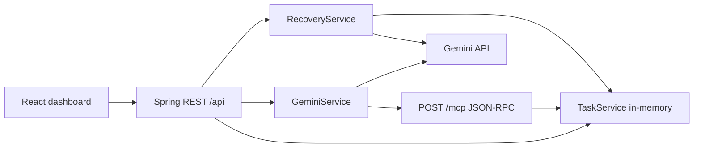

# TaskPilot — AI Study Recovery Agent

Recover missed study work by ranking **actual pending tasks**, then executing only the tasks a user explicitly approves.

## Problem and solution

When study time is missed, a task list is not a plan. TaskPilot generates a recovery proposal from the live pending store, shows recommended and deferred work, and completes recommended tasks only after approval. Cancel leaves state unchanged.

## Core features

- Create, list, filter, and complete in-memory study tasks.
- Dashboard counts are store-wide, independent of the current list filter.
- Recovery proposals are built from current pending tasks. The proposal itself does not mutate tasks.
- Approve completes matching pending tasks. Cancel and revise do not write the store.
- Read-only Gemini inspector may call MCP `list_tasks`. It cannot add or complete tasks.
- Self-hosted MCP tools: `add_task`, `list_tasks`, `complete_task`. REST and MCP share one `TaskService`.

Task data is lost on backend restart. There is no calendar, deadline, auth, or durable persistence layer.

## Distinctive approach

Recovery is an approval workflow, not autonomous mutation. Gemini is used for proposal text and for optional read-only inspection. MCP is the tool surface for task operations, including the inspector’s `list_tasks` call.

## Technology stack

- Java 17, Spring Boot 3.3, Jackson
- React 19, TypeScript, Vite
- Gemini `generateContent` from the backend (`x-goog-api-key`)
- Official MCP Java schemas (`io.modelcontextprotocol.sdk`, 2.0.1) plus a custom Streamable HTTP JSON-RPC endpoint

## Architecture



## End-to-end workflow

1. Add pending tasks in the dashboard (or via MCP `add_task`).
2. Describe missed work in **AI recovery**.
3. Review explanation, priorities, deferred items, and assumptions.
4. Approve to complete recommended pending tasks, or cancel with no writes.
5. Optionally ask the inspector for a read-only summary (`list_tasks` over MCP).

## Prerequisites

- Java 17+
- Maven 3.6+
- Node.js 18+ and npm
- `GEMINI_API_KEY` only for live recovery and inspector calls

## Environment

Backend (never put Gemini credentials in frontend files):

```bash
export GEMINI_API_KEY=your_key
# optional; default gemini-3.8-flash
export GEMINI_MODEL=gemini-3.8-flash
# optional; default http://localhost:5173
export TASKPILOT_CORS_ALLOWED_ORIGINS=http://localhost:5173
```

Frontend (browser-visible API location only):

```bash
printf 'VITE_API_BASE_URL=http://localhost:8080\n' > Frontend/.env
```

`.env` files are gitignored.

## Run

```bash
# Terminal 1
cd Backend
mvn spring-boot:run

# Terminal 2
cd Frontend
npm ci
npm run dev
```

Open `http://localhost:5173`. `http://localhost:8080` is the API process.

## Tests and verification

```bash
cd Backend && mvn test && mvn package
cd ../Frontend && npm run build && npm run lint
```

## MCP

Implemented protocol: **MCP 2025-11-25**. Transport: **Streamable HTTP** with JSON responses on `POST /mcp`. SSE notifications are not offered (`GET /mcp` returns 405).

Handshake:

1. `POST /mcp` `initialize` with `protocolVersion: "2025-11-25"`, `Accept: application/json, text/event-stream`.
2. Keep `MCP-Session-Id`. Send `MCP-Protocol-Version: 2025-11-25` on later requests.
3. `notifications/initialized` (HTTP 202), then `tools/list` or `tools/call`.

Tools: `add_task` (`title`), `list_tasks` (`status`: ALL | PENDING | COMPLETED), `complete_task` (`task_id`).

Verified locally with Spring MockMvc and HTTP JSON-RPC. **Not verified** against Alexa+ production, Amazon’s MCP inspector, or a third-party Streamable HTTP client binary in this environment.

## Gemini

Recovery and inspector calls run only on the backend. Missing `GEMINI_API_KEY` leaves task CRUD and MCP available. Recovery with pending tasks then returns HTTP 503. Empty pending lists return a no-op proposal without calling Gemini.

The inspector may invoke MCP `list_tasks`. Recovery generation is structured JSON from pending titles, not a mutation tool. Live Gemini execution is **NOT VERIFIED** unless `GEMINI_API_KEY` is present in the local environment.

## Hackathon route

Official sources: [hackathon home](https://amazonappdev2026.devpost.com/) and [official rules](https://amazonappdev2026.devpost.com/rules).

Alexa+ allows either:

1. A self-hosted MCP server, spec **2025-11-25+**, Streamable HTTP, or an Agent Skill.
2. A simulated Alexa+ experience in a web app.

TaskPilot targets route 1. The repository contains a runtime MCP JSON-RPC server at `POST /mcp`. Judges, not this README, decide track eligibility. This project is **not** an Alexa Agent Skill and has **not** been connected to Alexa+.

## Known limitations

- In-memory store only.
- No authentication.
- Streamable HTTP here returns JSON; it does not open an SSE stream.
- Gemini model availability depends on the configured `GEMINI_MODEL`.
- Duplicate task titles can all match a recommended title on approve.

## Demo

1. Add three pending study tasks.
2. Generate a recovery proposal from a missed-work prompt.
3. Approve and confirm dashboard counts.
4. `initialize` + `tools/list` + `tools/call` on `POST /mcp`, then refresh the dashboard.

## Submission assets

- Demo video URL: **TODO**
- Public or reviewer-shared GitHub URL: **TODO**
- Devpost product feedback: **TODO**

License: MIT (`LICENSE`).
