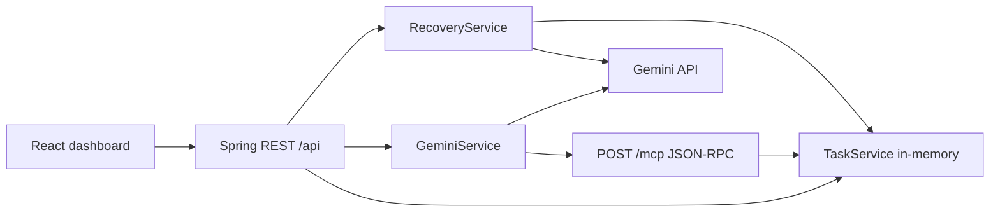

# TaskPilot — AI Study Recovery Agent

[](https://task-pilot-ai-study-recovery-agent.vercel.app/)
[](https://taskpilot-ai-study-recovery-agent.onrender.com)
[](https://github.com/aryangaikwad-966/TaskPilot-AI-Study-Recovery-Agent)

TaskPilot is an AI-assisted study recovery application that helps students turn missed study sessions into actionable recovery proposals while keeping task changes under user control.

## Overview

Students can fall behind because of missed study sessions, deadlines, and competing tasks. Simply generating a generic schedule may not explain what to prioritize, defer, or recover. TaskPilot addresses this by:

1. Managing study tasks through a dashboard and MCP tools.
2. Generating a proposed recovery plan from real pending tasks via Gemini.
3. Requiring user review and approval before any supported task change.
4. Offering a read-only Task Inspector that uses MCP `list_tasks`.

The AI proposes a plan; the user retains control over supported state-changing operations.

## Key features

- **Task management** — create, list, filter (ALL / PENDING / COMPLETED), and complete in-memory study tasks.
- **AI recovery proposals** — Gemini generates explanation, recommended priorities, deferred items, and assumptions from real pending tasks.
- **Explicit approval/cancellation** — Approve completes only matching pending recommended tasks; Cancel and Revise leave state unchanged.
- **Read-only Task Inspector** — sends prompts to Gemini, which may call MCP `list_tasks` only. It cannot add or complete tasks.
- **MCP tool surface** — `add_task`, `list_tasks`, `complete_task` over Streamable HTTP JSON-RPC, sharing the same `TaskService` as REST.
- **Deterministic fallback** — when `GEMINI_API_KEY` is missing, recovery returns a clearly-labelled local fallback proposal instead of calling Gemini.
- **Error handling** — missing key, API errors, timeouts, and invalid tool calls are handled safely.

## Architecture



## Technology stack

| Technology | Purpose |
|---|---|
| Java 17 | Backend runtime |
| Spring Boot 3.3 | REST API, MCP endpoint |
| Maven | Build tool |
| React 19 | Frontend UI |
| TypeScript | Frontend typing |
| Vite | Frontend bundler/dev server |
| Gemini API | AI recovery + inspector |
| MCP Java SDK schemas 2.0.1 | MCP protocol types |
| JUnit 5 + Mockito | Backend tests |
| Vercel | Frontend hosting |
| Render | Backend hosting |

## MCP integration

- **Endpoint:** `POST /mcp`
- **Protocol version:** `2025-11-25`
- **Transport:** Streamable HTTP (JSON responses; `GET /mcp` returns 405)
- **Negotiation:** client sends `initialize` with `protocolVersion: "2025-11-25"` and `Accept: application/json, text/event-stream`; server returns the same protocol version and an `MCP-Session-Id`; later requests include `MCP-Protocol-Version: 2025-11-25`.

Tools:

| Tool | Inputs | Effect |
|---|---|---|
| `add_task` | `title` (string) | Creates a task |
| `list_tasks` | `status`: ALL / PENDING / COMPLETED | Reads tasks |
| `complete_task` | `task_id` | Marks task COMPLETED |

All tools operate on the same in-memory `TaskService` as REST. REST and MCP share one store.

Example discovery/invocation uses standard JSON-RPC `initialize` → `notifications/initialized` → `tools/list` / `tools/call`. Verified locally via Spring MockMvc and direct HTTP; not verified against a third-party MCP client binary or Alexa+ production.

## AI recovery workflow

1. Backend loads current pending tasks from `TaskService`.
2. `RecoveryService` builds a prompt using only task titles and the user message; it instructs Gemini not to invent deadlines, time constraints, or preferences.
3. Gemini returns structured JSON (explanation, recommendedTasks, deferredTasks, assumptions).
4. Proposal is returned to the frontend without mutating tasks.
5. **Approve** completes only matching pending recommended tasks.
6. **Cancel/Revise** leave state unchanged.
7. Missing key → local fallback proposal (clearly labelled). API errors/timeouts handled safely.

## REST API

| Method | Endpoint | Purpose |
|---|---|---|
| GET | `/api/tasks?status=ALL\|PENDING\|COMPLETED` | List tasks + counts |
| POST | `/api/tasks` | Create task (`{title}`) |
| PATCH | `/api/tasks/{id}/complete` | Complete task |
| POST | `/api/recovery` | Generate recovery proposal |
| POST | `/api/recovery/approve` | Approve proposal (`{taskIds}`) |
| POST | `/api/chat` | Read-only inspector |

## Project structure

```
Taskpilot/
├── Backend/
│   ├── pom.xml
│   ├── Dockerfile
│   └── src/main/java/com/taskpilot/
│       ├── controller/ChatController.java
│       ├── service/{TaskService,GeminiService,RecoveryService,ChatService}.java
│       ├── mcp/{McpProtocolController,McpClientAdapter,TaskMcpTools}.java
│       └── model/Task.java
├── Frontend/
│   ├── package.json
│   └── src/{App.tsx,App.css,api.ts,types.ts}
└── README.md
```

## Prerequisites

- Java 17+
- Maven 3.6+
- Node.js 18+ and npm
- `GEMINI_API_KEY` (only for live recovery/inspector)

## Local setup

```bash
# Backend
cd Backend
export GEMINI_API_KEY=YOUR_GEMINI_API_KEY
mvn spring-boot:run

# Frontend (another terminal)
cd Frontend
npm ci
npm run dev
```

Open `http://localhost:5173`. API at `http://localhost:8080`.

Frontend API base URL (optional): create `Frontend/.env` with `VITE_API_BASE_URL=http://localhost:8080`.

## Environment variables

| Variable | Service | Purpose | Required? |
|---|---|---|---|
| `GEMINI_API_KEY` | Backend | Gemini auth | For live AI |
| `GEMINI_MODEL` | Backend | Model name (default gemini-3.1-flash-lite) | No |
| `TASKPILOT_CORS_ALLOWED_ORIGINS` | Backend | CORS origins (default http://localhost:5173) | No |
| `PORT` | Backend/Render | Listen port (default 8080) | No |
| `VITE_API_BASE_URL` | Frontend | Backend URL | For prod |

Gemini credentials stay backend-only. Never commit secrets or expose them via `VITE_` variables.

## Testing

```bash
cd Backend && mvn test
cd Frontend && npm run build && npm run lint
```

Backend: 40 tests pass. Frontend: build and lint pass.

## Deployment

- Frontend: https://task-pilot-ai-study-recovery-agent.vercel.app/
- Backend: https://taskpilot-ai-study-recovery-agent.onrender.com

Frontend is hosted on Vercel; backend on Render. Set `VITE_API_BASE_URL` to the Render URL for production and configure CORS accordingly. Task state is in-memory and may be lost on restart/redeploy.

## Security and limitations

- No authentication or user isolation.
- In-memory storage only (state lost on restart).
- No durable persistence, calendar, or deadline logic.
- Gemini model availability depends on configured model.
- Duplicate task titles can all match a recommended title on approve.
- Streamable HTTP returns JSON; no SSE stream.

## Hackathon context

TaskPilot targets the **Alexa+ track** of the Amazon Developer Hackathon 2026. It is a self-hosted MCP server (protocol 2025-11-25, Streamable HTTP) exposing task operations to compatible MCP clients. It is not an Alexa Agent Skill and has not been connected to Alexa+ or AWS production. Official rules: https://amazonappdev2026.devpost.com/rules

## License

MIT (`LICENSE`).
