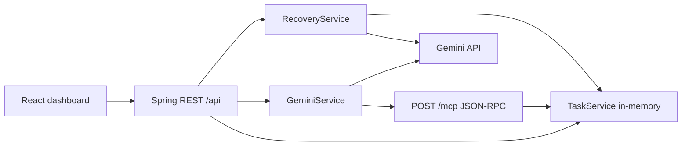

# TaskPilot — AI Study Recovery Agent

**Built for the Amazon Developer Hackathon 2026 · Alexa+ Track**

[](https://task-pilot-ai-study-recovery-agent.vercel.app/)
[](https://taskpilot-ai-study-recovery-agent.onrender.com)
[](https://github.com/aryangaikwad-966/TaskPilot-AI-Study-Recovery-Agent)

TaskPilot is an AI-assisted study recovery agent that helps students recover from missed study sessions by generating actionable plans from pending tasks while keeping task changes under user control.

**Hackathon:** [Amazon Developer Hackathon 2026](https://amazonappdev2026.devpost.com/)  
**Track:** Alexa+  
**MCP Transport:** Streamable HTTP  
**MCP Protocol Version:** `2025-11-25`

> **Track implementation note:** TaskPilot provides a self-hosted MCP server for compatible clients. Direct integration with an Alexa+ device or production environment has not been verified.

## Live Demo

- **Frontend:** https://task-pilot-ai-study-recovery-agent.vercel.app/
- **Backend:** https://taskpilot-ai-study-recovery-agent.onrender.com
- **GitHub Repository:** https://github.com/aryangaikwad-966/TaskPilot-AI-Study-Recovery-Agent
- **Hackathon Rules:** https://amazonappdev2026.devpost.com/rules

---

## The Problem

Students can fall behind when study sessions are missed and deadlines compete for attention. Generic AI-generated schedules may suggest changes without showing how those recommendations relate to actual tasks or ensuring the student remains in control.

## The Solution

TaskPilot combines task management, AI-assisted recovery planning, and MCP-based task operations in one application.

It retrieves pending tasks, generates a recovery proposal using Gemini when configured, and lets the student review the proposal before approving supported changes.

**The AI proposes. The student decides.**

## Key Features

- **Task Management:** Create, list, filter, and complete study tasks.
- **AI Study Recovery:** Generate recovery proposals from existing pending tasks.
- **Human Approval:** Review recommendations before supported task changes are applied.
- **Task Inspector:** Inspect task information through a read-only MCP tool workflow.
- **MCP Integration:** Expose supported task operations through a self-hosted MCP endpoint.
- **Fallback Handling:** Provide a clearly labelled local recovery proposal when the Gemini API key is unavailable.

## Architecture



## Technology stack

| Technology | Purpose |
|---|---|
| Java 17 | Backend runtime |
| Spring Boot 3.3 | REST API, MCP endpoint |
| Maven | Build tool |
| React 19 | Frontend UI |
| TypeScript | Frontend typing |
| Vite | Frontend bundler/dev server |
| Gemini API | AI recovery + inspector |
| MCP Java SDK schemas 2.0.1 | MCP protocol types |
| JUnit 5 + Mockito | Backend tests |
| Vercel | Frontend hosting |
| Render | Backend hosting |

## MCP integration

- **Endpoint:** `POST /mcp`
- **Protocol version:** `2025-11-25`
- **Transport:** Streamable HTTP (JSON responses; `GET /mcp` returns 405)
- **Tools:** `add_task`, `list_tasks`, `complete_task` — all operating on the same in-memory `TaskService` as REST.

Verified locally via Spring MockMvc and direct HTTP; not verified against a third-party MCP client binary or Alexa+ production.

## REST API

| Method | Endpoint | Purpose |
|---|---|---|
| GET | `/api/tasks?status=ALL\|PENDING\|COMPLETED` | List tasks + counts |
| POST | `/api/tasks` | Create task (`{title}`) |
| PATCH | `/api/tasks/{id}/complete` | Complete task |
| POST | `/api/recovery` | Generate recovery proposal |
| POST | `/api/recovery/approve` | Approve proposal (`{taskIds}`) |
| POST | `/api/chat` | Read-only inspector |

## Local setup

```bash
# Backend
cd Backend
export GEMINI_API_KEY=YOUR_GEMINI_API_KEY
mvn spring-boot:run

# Frontend (another terminal)
cd Frontend
npm ci
npm run dev
```

Open `http://localhost:5173`. API at `http://localhost:8080`.

## Environment variables

| Variable | Service | Purpose | Required? |
|---|---|---|---|
| `GEMINI_API_KEY` | Backend | Gemini auth | For live AI |
| `GEMINI_MODEL` | Backend | Model name (default gemini-3.1-flash-lite) | No |
| `TASKPILOT_CORS_ALLOWED_ORIGINS` | Backend | CORS origins | No |
| `PORT` | Backend/Render | Listen port (default 8080) | No |
| `VITE_API_BASE_URL` | Frontend | Backend URL | For prod |

## Testing

```bash
cd Backend && mvn test
cd Frontend && npm run build && npm run lint
```

Backend: 40 tests pass. Frontend: build and lint pass.

## Deployment

- Frontend: https://task-pilot-ai-study-recovery-agent.vercel.app/
- Backend: https://taskpilot-ai-study-recovery-agent.onrender.com

Task state is in-memory and may be lost on restart/redeploy.

## Limitations

- No authentication or user isolation.
- In-memory storage only.
- No durable persistence, calendar, or deadline logic.
- Streamable HTTP returns JSON; no SSE stream.

## License

MIT (`LICENSE`).
